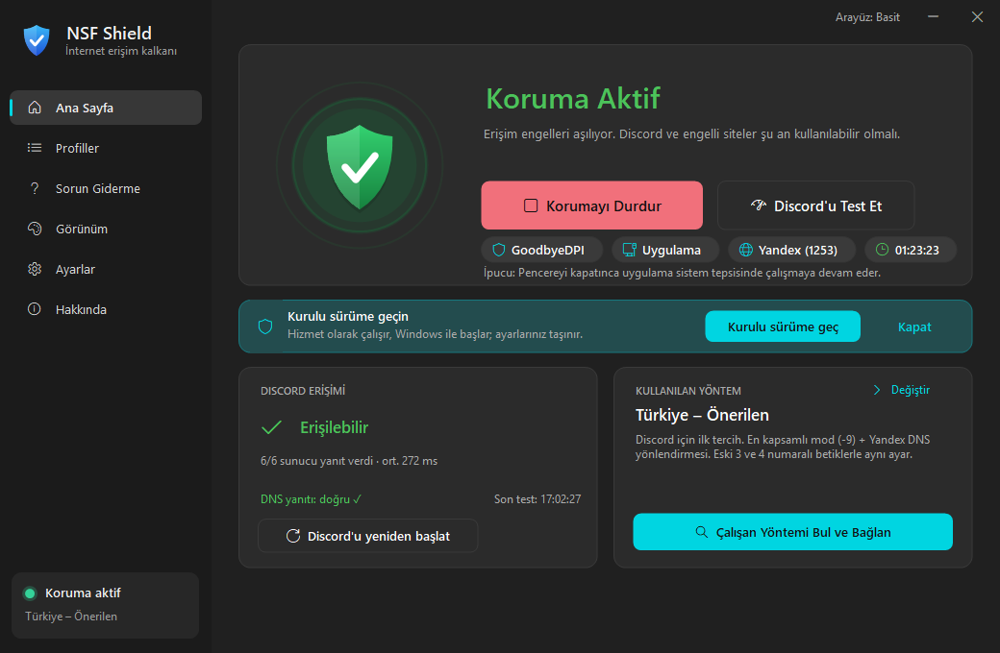
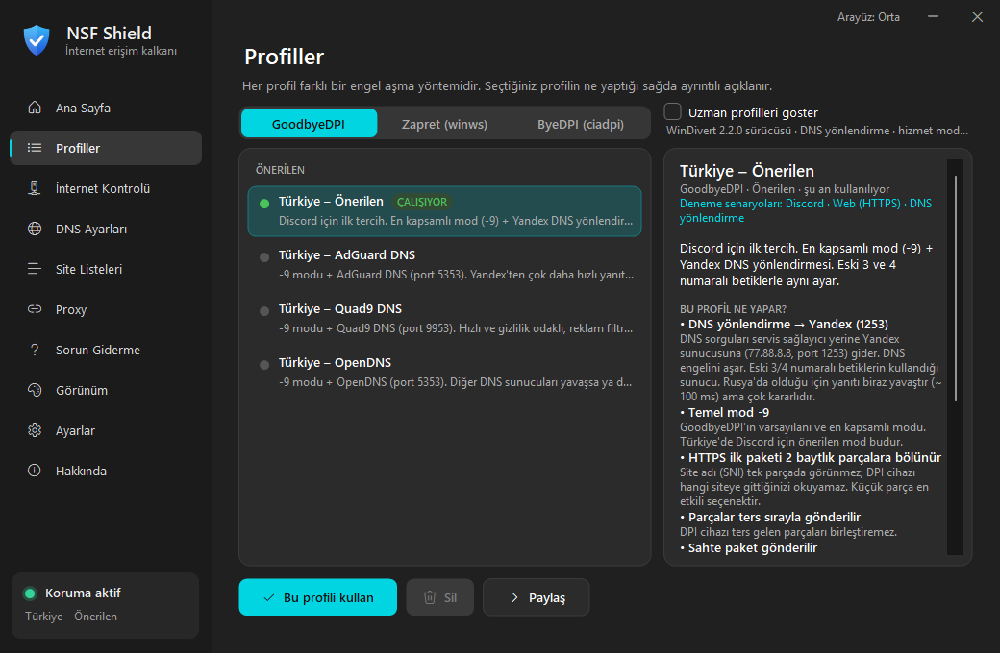
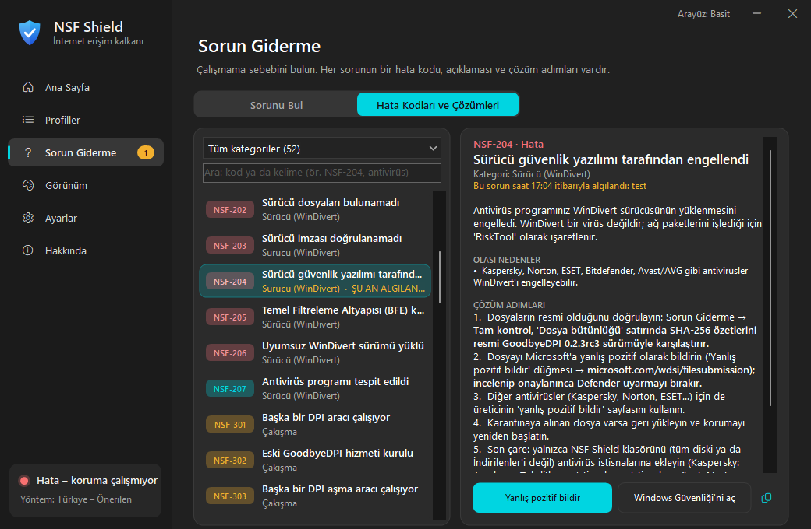
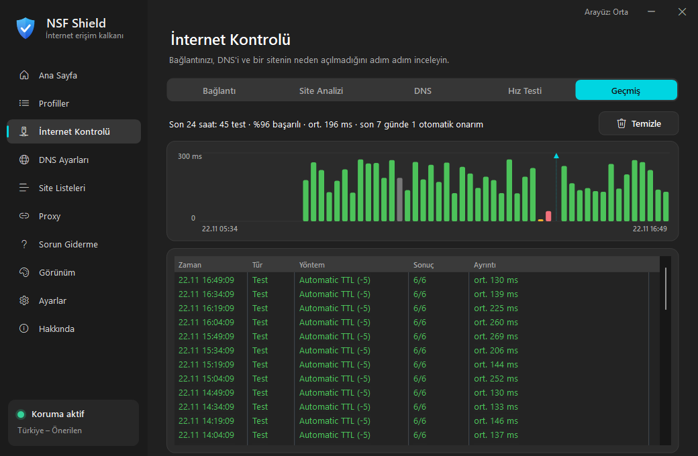
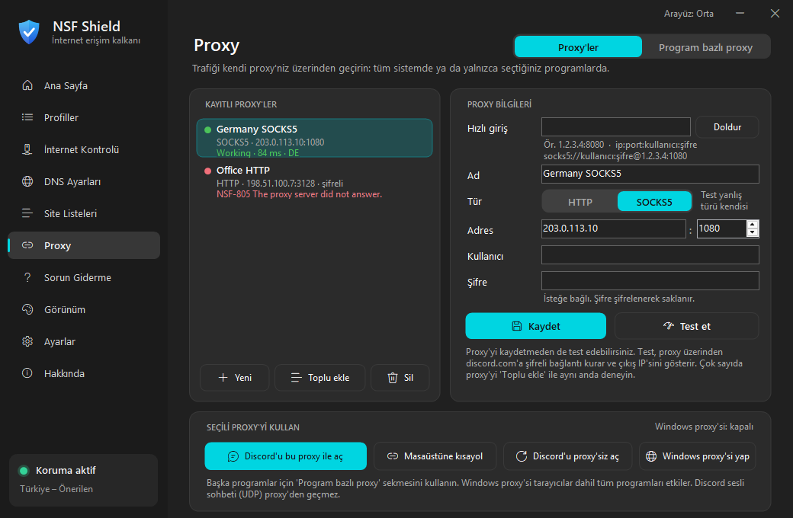
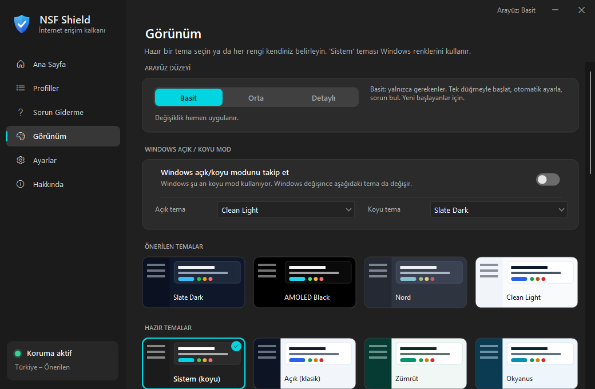
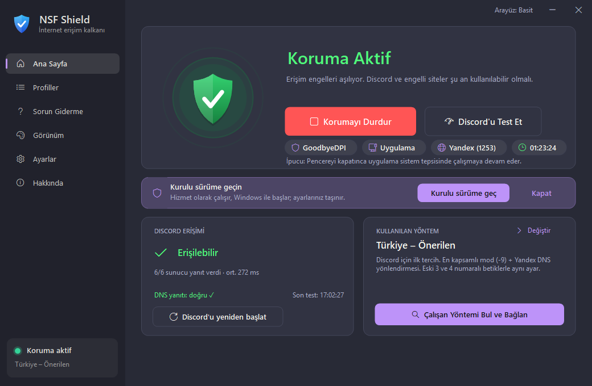

# NSF Shield — by Nightshift

[](https://github.com/Mr-Leywin/nsf-shield/actions/workflows/build.yml) [](https://github.com/Mr-Leywin/nsf-shield/releases/latest) [](LICENSE)

**Üç DPI aşma motoru için kolay kullanımlı internet erişim kalkanı: GoodbyeDPI, Zapret (winws) ve ByeDPI (ciadpi).** Servis sağlayıcıların DNS ve DPI (Derin Paket İnceleme) ile uyguladığı erişim engellerini (ör. Discord) aşar; çalışan yöntemi kendisi bulur. Arayüz Türkçe ve İngilizce'dir.

> VPN değildir: trafiğiniz şifrelenmez, IP adresiniz değişmez. Yalnızca Windows 10/11.

> **Sorumluluk reddi / Disclaimer:** Bu yazılım MIT lisansı ile 'olduğu gibi' (AS IS) sunulur; ağ sürücüsü, DNS ve sistem proxy ayarlarında değişiklik yapar. Belirli bir İSS'de, oyunda veya hile koruma sisteminde çalışma garantisi vermez; kullanım sorumluluğu kullanıcıya aittir.
> This software is provided 'as is' under the MIT License; it changes network driver, DNS and system proxy settings. It is not guaranteed to work with any particular ISP, game or anti-cheat system; you use it at your own responsibility.



## İndir ve kur

**[Son sürümü indir (Releases)](https://github.com/Mr-Leywin/nsf-shield/releases/latest)**

| | **Kurulumlu** – `NSF-Shield-x.y.z-Setup.exe` (yeni kurulumlar için önerilen) | **Taşınabilir** – `NSF-Shield-x.y.z.zip` |
|---|---|---|
| Kurulduğu yer | `C:\Program Files\NSF Shield` (yalnızca yöneticiler değiştirebilir) | Seçtiğiniz herhangi bir klasör |
| Koruma (uygulama modu) | ✔ | ✔ |
| Arka plan hizmeti (GoodbyeDPI, Zapret) | ✔ | – (güvenlik gereği kapalı) |
| Windows açılışında otomatik başlatma | ✔ | – (güvenlik gereği kapalı) |
| Güncelleme | Yalnızca doğrulanmış kurulum paketiyle | ZIP ile, yerinde |
| Kaldırma | Ayarlar → Uygulamalar | Ayarlar → Temiz kaldır, sonra klasörü silin |
| Windows | 64 bit | 32 ve 64 bit (Zapret ve ByeDPI yalnızca 64 bit) |

**Yönetici izni ve "taşınabilir" ayrı kavramlardır.** Program kurulumlu da taşınabilir de olsa her açılışta yönetici izni ister (`app.manifest` → `requireAdministrator`): WinDivert sürücüsü ve Windows DNS/proxy ayarları bunu gerektirir. İki biçim arasındaki fark yalnızca klasörün korunup korunmadığıdır.

**Hangisini seçmeliyim?** Yeni kurulumlarda `Setup.exe` önerilir. Taşınabilir ZIP, kurulum yapmadan bir klasörden çalıştırmak isteyenler içindir; taşınabilir kopya kendini ZIP ile yerinde günceller, kurulu kopya yalnızca doğrulanmış `Setup.exe` ile. Taşınabilir bir kopya istediğinde **Ayarlar → Kurulum paketine geç** ile ayarlarını koruyarak kurulumlu sürüme geçebilir.

Windows "Bilgisayarınız korundu" derse **Ek bilgi → Yine de çalıştır** deyin (nedeni: [Antivirüs, SmartScreen ve doğrulama](#antivirüs-smartscreen-ve-doğrulama)). .NET Framework 4.8 Windows 10/11'de zaten yüklüdür. Ayrıntılı rehber pakette iki dilli `Guide.html` olarak bulunur; uygulama ve Başlat menüsü onu sizin dilinizde açar.

### Hizmet ve otomatik başlatma neden yalnızca kurulumlu sürümde?

Arka plan hizmeti motoru **SYSTEM** yetkisiyle, "Windows açılışında başlat" ise NSF Shield'i **izin sormadan yönetici olarak** çalıştırır. Herkesin yazabildiği bir klasördeki dosyalar bu yetkilerle çalıştırılırsa, zararlı bir program o dosyaları değiştirip yetki kazanabilir. Bu yüzden bu iki özellik yalnızca Program Files gibi **yöneticilerin yazabildiği bir klasörde** açılır. Korumasız bir klasörü gösteren hizmet ya da açılış görevi açılışta kaldırılır ve bildirilir (NSF-705).

### Güncelleme

Uygulama günde bir kez yeni sürümü denetler ve ana sayfada bildirir; kurulum sizin onayınızla yapılır. İndirilen dosyanın SHA-256 özeti doğrulanır, ayarlar korunur. Kurulu kopya sessiz yükseltme yapar ve kendini yeniden açar; taşınabilir kopya yerinde güncellenir ve önceki sürüm `data\previous-version` klasörüne yedeklenir.

### Kaldırma

Arka plan hizmeti, açılış görevi, bu klasöre ait WinDivert sürücü kayıtları, Windows proxy'si, DNS sunucuları ve şifreli DNS kayıtları NSF Shield'den önceki hâline döndürülür:
- **Kurulumlu:** Ayarlar → Uygulamalar → NSF Shield → Kaldır.
- **Taşınabilir:** Uygulamada **Ayarlar → Temiz kaldır**, ardından klasörü silin.
- **Komut satırı:** `NSFShield.exe --uninstall` (sessiz: `--uninstall --quiet`).

## Antivirüs, SmartScreen ve doğrulama

- **SmartScreen:** NSF Shield henüz bir kod imzalama sertifikasıyla imzalı değildir.
- **Antivirüs:** GoodbyeDPI ve Zapret ağ paketlerini **WinDivert** sürücüsüyle işler; bazı antivirüsler bunu "HackTool" ya da "RiskTool" olarak işaretleyebilir. Motor dosyaları resmi sürümlerden **değiştirilmeden** alınmıştır. ByeDPI sürücü kullanmaz.

**Dosyaları doğrulama:**
1. **SHA-256:** Her sürümün `NSF-Shield-x.y.z.SHA256SUMS.txt` dosyası önce ZIP'in, sonra kurulum paketinin, ardından paketteki **tüm dosyaların** özetlerini içerir:
   ```powershell
   Get-FileHash .\NSF-Shield-x.y.z-Setup.exe -Algorithm SHA256
   ```
2. **Derleme kaynağı kanıtı (build provenance):** Yayın dosyaları GitHub Actions'ta bu depodaki koddan derlenir ve imzalı bir kanıtla yayımlanır:
   ```powershell
   gh attestation verify .\NSF-Shield-x.y.z-Setup.exe -R Mr-Leywin/nsf-shield
   ```
3. **Uygulama içinde:** Sorun Giderme → **Tam kontrolü başlat** motor dosyalarını programa gömülü resmi SHA-256 özetleriyle karşılaştırır; bu denetim her başlatmada da yapılır (NSF-105).

Antivirüs dosyayı engellerse: dosyanın resmi olduğunu doğrulayın, Microsoft'a **yanlış pozitif** olarak bildirin ([microsoft.com/wdsi/filesubmission](https://www.microsoft.com/en-us/wdsi/filesubmission)) ve istisnayı **yalnızca son çare olarak** yalnızca NSF Shield klasörü için ekleyin.

## Özellikler

- **Üç motor:** GoodbyeDPI 0.2.3rc3 (WinDivert; DNS yönlendiren tek motor), Zapret v72.13 `winws` (kendi WinDivert sürücüsü; TCP, QUIC ve Discord sesi kuralları) ve **sürücüsüz** ByeDPI 0.17.3 `ciadpi` (127.0.0.1 üzerinde yerel SOCKS proxy; yalnızca uygulama modu). Motor dosyaları her başlatmada SHA-256 ile doğrulanır, parametreler motorun izin listesinden geçer.
- **38 hazır yöntem:** GoodbyeDPI 22, Zapret 9, ByeDPI 7; **Önerilen** ve **Uzman** katmanları ve deneme senaryosu etiketleri (vaat değildir).
- **Basit / Orta / Detaylı arayüz:** Basit'te Korumayı Başlat/Durdur ve **Çalışan Yöntemi Bul ve Bağlan**; Orta'da motor sekmeleri ve tarama seçenekleri; Detaylı'da düzenleyiciler, aday matrisi ve katman sonuçları.
- **Akıllı tarayıcı:** *İlk çalışanda dur* (yalnızca iki turda tam başarıda uygular) ve *Tümünü karşılaştır* (kendiliğinden uygulamaz). Adaylar yalıtılmış çalışır; ayarlar ve listeler değişmez, önceki durum geri gelir. HTTPS hedefleri genel IP'ye sabitlenir ve tam sertifika denetimiyle ölçülür; Discord Gateway **"Gateway bağlantısı"** olarak sınırlı bir WebSocket açılışıyla denetlenir (oturum, ses ya da oyun anlamına gelmez); UDP/STUN bilgi amaçlıdır.
- **Site listeleri:** *Dahil* (hedefli mod) üç motorda; *Hariç* Zapret ve ByeDPI'da çalışır (GoodbyeDPI'ın hariç listesi yoktur).
- **Sorun Giderme:** tam denetim, 10 kategoride 52 hata kodu (NSF-xxx) ve çözüm adımları. Salt okunur **çakışma teşhisi**: DPI süreçlerinin sahibi tam yol ve süreç kimliğiyle ayrılır; WinDivert sürücü kayıtları; Riot Vanguard, FACEIT, EasyAntiCheat ve BattlEye için yalnızca çalışan çekirdek sürücüsü "etkin" sayılır ("erişim reddedildi" ayrı gösterilir); VPN/WARP için bağdaştırıcı, hizmet ve rota ayrı bulgulardır. Etkin hile önleyici sürücüsü ile WinDivert motoru birlikteyse bir kart sürücüsüz ByeDPI'ı açıklar; uyumluluk garantisi verilmez.
- **Ağ değişimi:** DNS çipi ve bağdaştırıcı özeti güncellenir; ağ olayı test, onarım ya da tarama başlatmaz.
- **DNS:** GoodbyeDPI ile DNS yönlendirme; Windows DNS'ini değiştirme ve Windows 11'de şifreli DNS (DoH), tamamen geri alınabilir.
- **Profil paylaşımı:** `NSF1:` kodları (yalnızca yöntem; ayar, liste, yol ya da şifre içermez; boyut ve XML sınırları sıkıdır).
- **Proxy:** HTTP/SOCKS5, toplu test, Windows proxy'si, program bazlı proxy ve yerel kimlik doğrulama köprüsü.
- **Görünüm, yedek betikler, güncelleme, temiz kaldırma ve kişisel bilgileri gizlenmiş destek paketi.**

| | |
|---|---|
|  |  |
|  |  |
|  |  |

## Nasıl çalışır?

Türkiye'de Discord iki katmanda engelleniyor: **DNS** (sahte adres) ve **DPI** (bağlantıdaki site adının okunup kesilmesi). NSF Shield seçtiğiniz motoru doğrulanmış parametrelerle çalıştırır: GoodbyeDPI DNS'i standart dışı porttaki güvenli bir sunucuya yönlendirebilir; üç motor da paket bölme, sıra değiştirme ve sahte paket gibi yöntemlerle DPI cihazının site adını okumasını engeller. Hangi yöntemin çalıştığı servis sağlayıcıya göre değişir; tarayıcı bunu sizin bağlantınızda test eder.

## Kaynaktan derleme

Gereksinimler:
- Windows 10/11
- [.NET SDK](https://dot.net) – `global.json`'daki sürüm (8.0.201) önerilir; yalnızca derleyicisi kullanılır, uygulama .NET Framework 4.8 hedefler.
- Kurulum paketi için [Inno Setup](https://jrsoftware.org/isdl.php) 6.7.3

```powershell
powershell -ExecutionPolicy Bypass -File build.ps1                      # derle → dist\: ZIP, Setup.exe, SHA256SUMS (paket ağacı ve ZIP ile doğrulanır)
powershell -ExecutionPolicy Bypass -File build.ps1 -Preview             # ayrıca ekran görüntüleri → build\screens
powershell -ExecutionPolicy Bypass -File build.ps1 -Check               # yalnızca derleme kontrolü
powershell -ExecutionPolicy Bypass -File build.ps1 -NoSetup             # kurulum paketi olmadan
powershell -ExecutionPolicy Bypass -File build.ps1 -VerifyReproducible  # iki taze imzasız derleme: EXE, ZIP ve Setup ayrı ayrı karşılaştırılır
build\NSFShield.preview.exe --selftest build\selftest.txt               # öz-test: çıkış kodu 0 = tam, boş olmayan, hatasız koşu
```

- **Tekrarlanabilir derleme:** derleyici `-deterministic` çalışır, dosyalar sabit sırayla ve sabit zaman damgasıyla (son commit zamanı ya da `SOURCE_DATE_EPOCH`) paketlenir. ZIP ve Setup aynı paket ağacından üretilir. `-VerifyReproducible` yalnızca üç çıktı da iki kez üretilip aynı çıktığında "üç çıktı" sonucunu verir; Inno Setup yoksa başarısız olur, `-NoSetup` ile "kısmi" olarak bildirir. Kullanılan .NET SDK ve Inno Setup sürümleri yazdırılır.
- **İmzalama:** `NSF_SIGN_ARGS` (ve gerekirse `NSF_SIGNTOOL`) tanımlıysa EXE ve kurulum paketi imzalanır. Tekrarlanabilirlik kanıtı her zaman imzasız derlemelerle yapılır; zaman damgalı imzalı çıktılar ondan sonra ayrıca üretilir.
- **Öz-test çıkış kodları:** `0` tam ve hatasız; `1` başarısız kontrol; `3` beklenmeyen istisna; `4` rapor yazılamadı; `5` boş koşu; `6` eksik koşu; `64` çıktı dosyası verilmedi. Rapordaki `OK`/`FAIL` satırları ayrıca okunabilir.

Klasör yapısı:

| Klasör | İçerik |
|---|---|
| `src/Core` | Motorlar, güvenlik denetimleri, tarayıcı ve ağ ölçümleri, çakışma teşhisi, ağ izleyici, profil kodları, hata kataloğu, proxy, DNS, güncelleme, kaldırma |
| `src/UI` | WinForms arayüzü: tema sistemi ve sayfalar |
| `installer` | Inno Setup kurulum betiği (`NSFShield.iss`) |
| `locales` | Arayüz metinleri: `en.json` (asıl dil ve yedek) ve `tr.json` |
| `docs/Guide.html` | İki dilli rehber şablonu (hata kodları ve yöntemler derlemede her dil için eklenir; `guide\en.html` ve `guide\tr.html` giriş sayfaları üretilir) |
| `tests` | Yayın denetim betiğinin çevrimdışı testleri (sahte `gh` ile) |
| `third_party/goodbyedpi`, `third_party/zapret`, `third_party/byedpi` | Resmi motor dosyaları (değiştirilmemiş, SHA-256 listeli) |

### Yeni bir dil ekleme

1. `locales/en.json` dosyasını `locales/<kod>.json` olarak kopyalayın (ör. `de.json`). Dosya **UTF-8** olmalı.
2. `_meta` bloğunu doldurun: `code` (dosya adıyla aynı, ör. `de`), `name` (İngilizce adı, ör. `German`), `nativeName` (kendi dilindeki adı, ör. `Deutsch`).
3. Yalnızca değerleri çevirin. **Anahtarlar** `en.json` ile aynı kalmalı; `{0}`, `{1}` gibi **yer tutucular** aynı sayıda ve aynı numaralarla bulunmalı; listeler aynı uzunlukta olmalı. İngilizce dosya referanstır.
4. Çalışma zamanı: uygulama `locales` klasöründeki geçerli dosyaları kendisi bulur ve **Ayarlar → Language / Dil** listesinde gösterir. "Otomatik" seçeneği Windows görüntüleme dilinin dosyası varsa onu, yoksa İngilizce'yi kullanır. Bozuk dosyalar atlanır; çevrilmemiş anahtarlar tek tek İngilizce'ye (programa gömülü `en.json`) döner.
5. Paketleme: `build.ps1` `locales\*.json` dosyalarının hepsini pakete ve kurulum paketine koyar; `SHA256SUMS` onları da listeler. Öz-test `en`/`tr` dosyalarının anahtar, yer tutucu ve biçim eşitliğini denetler; yeni bir dil için aynı denetimleri eklemeniz önerilir. Rehber (`Guide.html`) şimdilik yalnızca İngilizce ve Türkçe'dir.

## Sürüm yayımlama (geliştiriciler için)

1. `src/Program.cs` içindeki `AssemblyVersion`, `AssemblyFileVersion` ve `AssemblyInformationalVersion` değerlerini artırın (üçü aynı sürüm olmalı; `build.ps1` denetler). `README.txt` ilk satırı `NSF SHIELD x.y.z` olmalı.
2. `CHANGELOG.md` dosyasına yeni sürümün bölümünü ekleyin.
3. Etiketleyin ve gönderin: `git tag vX.Y.Z` ve `git push origin vX.Y.Z`.

GitHub Actions paketi iki kez derleyip çıktıların aynı olduğunu doğrular, öz-testi çıkış koduyla denetler ve yalnızca sürüm etiketinde o sürümün `NSF-Shield-x.y.z-Setup.exe`, `NSF-Shield-x.y.z.zip` ve `NSF-Shield-x.y.z.SHA256SUMS.txt` dosyalarını derleme kaynağı kanıtıyla yayımlar. Sürüm notları önce ZIP ve Setup özetleriyle başlar. Tüm eylemler commit SHA'sıyla, Inno Setup sürümü ve özetiyle sabitlenmiştir; runner etiketi (windows-2025) GitHub'ın güncellediği değişken bir imajdır.

## Sorun bildirme

Uygulamada **Sorun Giderme → Sorun bildir** düğmesi bilgileri doldurulmuş bir sorun formu açar. **Destek paketi**, kişisel bilgileri gizlenmiş günlükleri tek dosyada toplar. Güvenlik açıkları için [SECURITY.md](SECURITY.md), katkı için [CONTRIBUTING.md](CONTRIBUTING.md). Değişiklikler: [CHANGELOG.md](CHANGELOG.md).

## Lisans

- **NSF Shield kaynak kodu:** [MIT](LICENSE), Copyright (c) 2026 Nightshift (Osman Barış MEDİNE).
- **Birlikte dağıtılan bileşenler** kendi lisanslarına tabidir:
  - GoodbyeDPI: Apache 2.0, © ValdikSS
  - WinDivert: LGPL v3, © basil00
  - zapret: MIT, © bol-van
  - ByeDPI: MIT, © hufrea
  - Ayrıntılar: [THIRD_PARTY_NOTICES.md](THIRD_PARTY_NOTICES.md)
- NSF Shield; GoodbyeDPI, WinDivert, zapret, ByeDPI ya da Discord geliştiricileriyle bağlantılı değildir.

## Sorumluluk reddi / Disclaimer

Bu yazılım MIT lisansı ile 'olduğu gibi' (AS IS) sunulur; ağ sürücüsü, DNS ve sistem proxy ayarlarında değişiklik yapar. Belirli bir İSS'de, oyunda veya hile koruma sisteminde çalışma garantisi vermez; kullanım sorumluluğu kullanıcıya aittir. Lütfen bulunduğunuz yerin yasalarına uygun kullanın.

This software is provided 'as is' under the MIT License; it changes network driver, DNS and system proxy settings. It is not guaranteed to work with any particular ISP, game or anti-cheat system; you use it at your own responsibility.

---

### English

**NSF Shield — by Nightshift** is a Windows GUI (English and Turkish) for three DPI bypass engines – [GoodbyeDPI](https://github.com/ValdikSS/GoodbyeDPI), [zapret](https://github.com/bol-van/zapret) (winws) and the driverless [ByeDPI](https://github.com/hufrea/byedpi) (ciadpi) – against DNS- and DPI-based censorship (e.g. the Discord block in Turkey).

- **Setup (recommended for new installations)** installs to Program Files; the SYSTEM background service and "start with Windows" are only available there. The app always requires administrator rights (`requireAdministrator`), installed or portable – "portable" only means an unprotected folder. The **portable ZIP** runs from any folder and updates itself in place with the next ZIP; an installed copy only updates with a verified Setup. A portable copy can move to the installed version with Settings → Switch to the setup package (settings are kept).
- Smart scanner with isolated candidate trials (Stop at first match / Compare all), IP-pinned strict TLS measurements, a bounded WebSocket "Gateway connection" check, optional STUN; a read-only conflict, anti-cheat and VPN diagnosis; a network-change watcher that never starts tests or repairs; `NSF1` share codes with strict size and XML limits; a bilingual `Guide.html`.
- **Verification:** every release ships `NSF-Shield-x.y.z.SHA256SUMS.txt` (the ZIP, the Setup, then every package file) and a GitHub build provenance attestation (`gh attestation verify <file> -R Mr-Leywin/nsf-shield`); `build.ps1 -VerifyReproducible` compares the EXE, the ZIP and the Setup of two fresh unsigned builds. Engine files are verified against embedded SHA-256 hashes before every start. Please report antivirus false positives instead of adding broad exclusions.
- **Adding a language:** copy `locales/en.json` to `locales/<code>.json` (UTF-8), fill `_meta.code`/`name`/`nativeName`, translate the values only (same keys and `{n}` placeholders); the app discovers it at run time, falls back to English per key, and `build.ps1` packages every `locales\*.json`.

The app's own code is MIT-licensed (Copyright (c) 2026 Nightshift (Osman Barış MEDİNE)); bundled GoodbyeDPI (Apache 2.0), WinDivert (LGPLv3), zapret (MIT) and ByeDPI (MIT) are unmodified.
